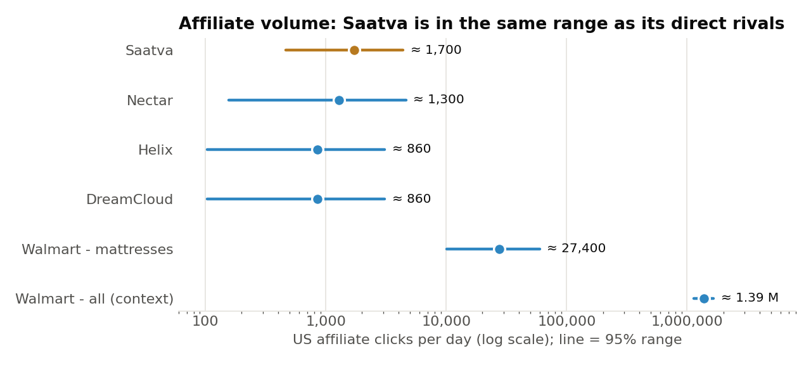
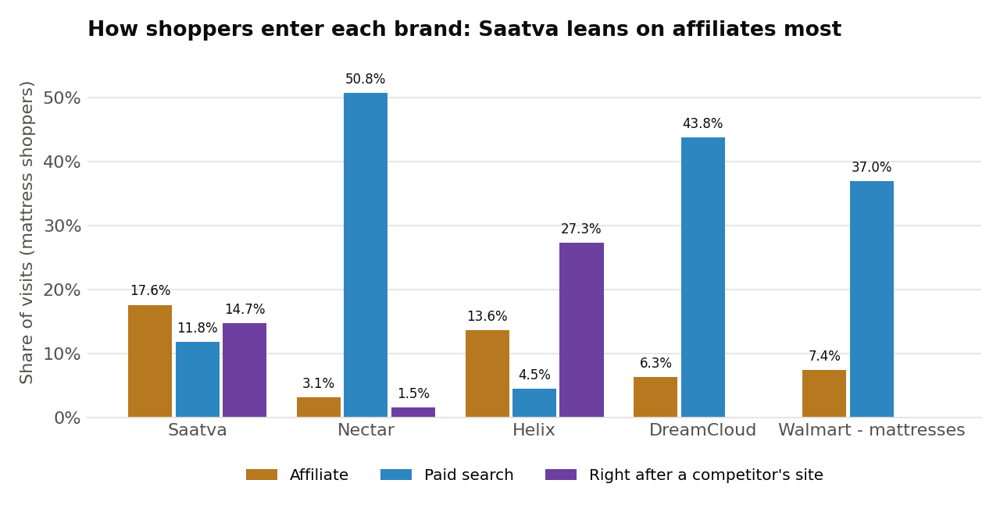
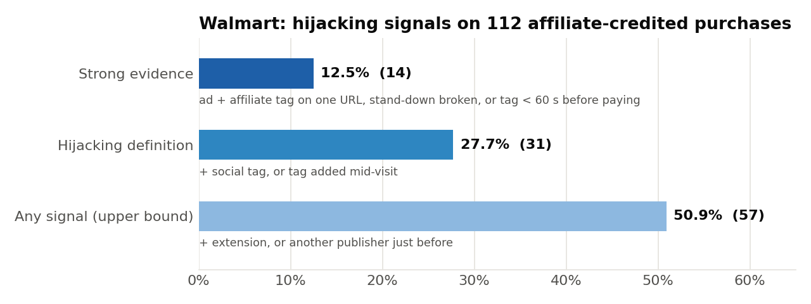
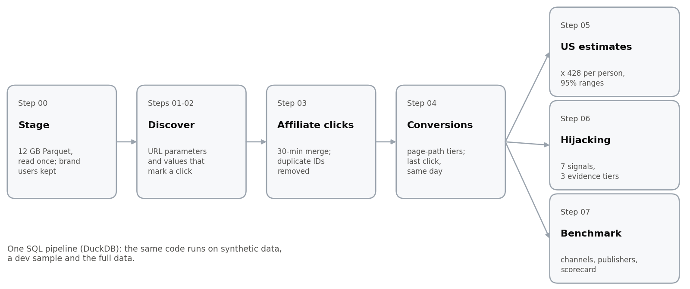

# Saatva's Affiliate Program vs. Competitors (US)

How Saatva's US affiliate program compares with Nectar, Helix, DreamCloud and Walmart (mattress section),
where it falls behind, how exposed it is to attribution hijacking, and what to do about it. Built from one
day of clickstream panel data (1 May 2026: 48.4 M events, 751,584 people) with a reproducible DuckDB SQL
pipeline.

> **In one sentence:** Saatva relies on affiliates more than any competitor, but depends on few
> publishers and has no stand-down flag. Protect the channel first, then widen it through review
> sites and creators.

---

## 1. Affiliate clicks and conversions per brand

| Brand | Panel affiliate clicks (people) | US affiliate clicks / day (95% range) | Panel conversions credited to an affiliate click | Conversion rate (95% range) |
|---|---:|---:|---:|---:|
| **Saatva** | **4 (4)** | **≈ 1,700** (470 - 4,400) | **0** | 0% (0 - 60%) |
| Nectar | 3 (2) | ≈ 1,300 (160 - 4,600) | 0 | 0% (0 - 84%) |
| Helix | 2 (2) | ≈ 860 (100 - 3,100) | 0 | 0% (0 - 84%) |
| DreamCloud | 2 (2) | ≈ 860 (100 - 3,100) | 0 | 0% (0 - 84%) |
| Walmart - mattress section | 64 (6) | ≈ 27,400 (10,100 - 59,700) | 0 | 0% (0 - 46%) |
| *Walmart - whole site (context)* | *3,234 (1,266)* | *≈ 1.39 M (1.14 - 1.66 M)* | *120 (≈ 51,400 / day in the US)* | *3.7% (2.9 - 4.9%)* |

*Conversion = purchase, payment, registration or other completion; last click, same day. US ranges: person-level
bootstrap (Walmart) or exact Poisson interval (≤ 10 people).*  
*Conversion rate: Clopper-Pearson exact 95% range, 0 of n people · person-level bootstrap 95% range (Walmart all).*



- **Volume is similar, reliance is not.** Saatva's affiliate clicks are in the same range as its direct
  rivals', but affiliates are a larger share of its visits than for any competitor (section 2). The ranges
  are wide because each DTC brand has 2 to 4 clicking people in the panel.
- **Conversions cannot be measured for the DTC brands from one day:** none of the 132 visitors of the four
  DTC sites bought anything that day, through any channel (purchase rate < 2.8%, 95%). 6 of 11 DTC
  affiliate clickers moved on to another mattress site (5 within 100 s), none of Saatva's 4: the click is
  part of the research stage, and Saatva tends to come at its end.
- **Walmart is compared through its mattress section** (53 visitors that day, the same order as Nectar).
  The whole site, 1.39 M clicks a day mostly on other products, is context only.

## 2. How Saatva's program compares



| | Saatva | Competitors |
|---|---|---|
| Share of visits from affiliates | **17.6%**, the highest | 3.1 - 13.6% |
| Active affiliate publishers that day | **3** | 2 per DTC rival; **20** in Walmart's mattress section |
| Affiliate clicks with the stand-down flag `afsrc=1` | **0%** | Nectar, Helix 100%; Walmart mattress 94%; DreamCloud 50% |
| Review / sleep-content sites | Sleep Foundation sends visitors, **unpaid** | Paid partners of mattressclarity, buyersguide, rtings |

Competitors lean on paid search (Nectar 50.8%, DreamCloud 43.8%, Walmart mattress 37.0% of visits); Saatva
gets only 11.8% from paid search and more from affiliates than anyone.

## 3. Attribution hijacking

**Hijacking** = organic, direct, social or paid traffic that receives an affiliate tag, so the last click
(and the commission) goes to a publisher that did not bring the visitor. Each affiliate landing is read from
the page before it and from its own URL parameters: 7 signals in 3 evidence tiers (strong, possible, context).

- **Saatva:** 1 of its 4 affiliate clicks carries both a Google-ad marker and an affiliate tag
  (`utm_source=brandxemail ... &gad_source=1`). With no `afsrc=1` on any link, coupon extensions get no
  cue to stand down, and a violation cannot even be detected.
- **What it costs at scale (Walmart, same last-click mechanics):**



- **All 39 Walmart clicks with an ad marker and an affiliate tag come from one publisher** (`imp_150372`,
  35 of them via the comparison engine Bizrate), with 29 distinct Bing ad-click IDs: real ad clicks,
  re-tagged as affiliate. This is Walmart's publisher on Impact, not Saatva's, but it shows the mechanism
  at scale and that one publisher can account for all of it: detectable and fixable.

## 4. Recommendations

| | Action | Evidence |
|---|---|---|
| **Protect** | Add `afsrc=1` to every Partnerize link; stand-down in partner terms | 0% of Saatva clicks vs. 50 - 100% for rivals |
| | Reverse commission on landings with `gclid` / `gad_source` / `msclkid` | 1 of 4 Saatva clicks; 39 Walmart clicks from one publisher |
| | No full commission for a tag set < 60 s before the order | 10 of 112 Walmart purchases |
| **Grow** | Recruit review and sleep sites (Sleep Foundation, mattressclarity, buyersguide, rtings) | Rivals pay these sites; Sleep Foundation already sends Saatva visitors |
| | Add creators and comparison content | Walmart's mattress section runs 20 publishers |
| **Measure** | 30+ days of Partnerize data | One day cannot show a mattress purchase |
| | Holdout test for incrementality | At Walmart, affiliate visitors buy more (9.6% vs 6.5%), but that is correlation |
| | Monthly publisher scorecard | Clicks per person, stand-down breaks, checkout clicks |

## 5. Method



- **Discovery from the data, not from memory:** affiliate markers per network (Partnerize `click_id`,
  Impact `irgwc` / `irclickid`, Walmart `veh=aff` / `wmlspartner=imp_...`) were found in the landing URLs and
  confirmed by their values; nearly every click is identified by two independent markers.
- **Counted by person:** the panel logs 4.1% of people under several IDs (Saatva: 7 clicks, 4 people).
- **One output for everything:** `brand_scorecard.csv` (step 07) holds every headline number per brand;
  every intermediate table is documented in its step's doc.
- **US scale:** 322 M US internet users (DataReportal 2025) / 751,584 panel people = 428.4. Ranges:
  person-level bootstrap for Walmart; exact intervals for small counts (Garwood for clicks,
  Clopper-Pearson for 0 of n people).

## 6. Assumptions and limits

- One day of data (Friday, 1 May 2026): no multi-day attribution window, no weekly pattern.
- The panel represents US internet users. It has no weights and most likely reflects desktop browsing
  more than mobile apps. Absolute US numbers are an order of magnitude; brand comparisons are much less affected.
- Last-click credit, same day. Walmart is compared through its mattress section.
- A hijacking signal is a reason to review, not proof.

## 7. Validation

1. **Synthetic data with planted cases:** every case recovered.
2. **Random 5% user sample:** the same affiliate signals at ~5% of the full-data users (4.3 - 4.9%).
3. **Dev sample** (every DTC and Walmart-mattress shopper + random 5% + their duplicate IDs): 13 DTC and
   mattress outputs, 0 differences from the full run.
4. **Full data in SQL (DuckDB):** 12 GB staged once; identical outputs on every rerun.

## 8. With more time

- 30 days of data and Partnerize's own conversions: 7- and 30-day windows, a measured conversion rate for Saatva.
- A publisher or geo holdout: do affiliates add sales, or only collect credit?
- Audit Saatva's own publishers for the same pattern (paid ad clicks re-tagged as affiliate), starting with
  `brandxemail`, using Partnerize's full click data.
- Panel weighting to the US population, bot filtering, matching of partial duplicate IDs.
- A daily pipeline with data tests, publisher-risk alerts and a competitor dashboard.

---

## Repository map

| Path | Content |
|---|---|
| `docs/00_external_inputs.md` | Public background: affiliate networks per brand, scaling input |
| `docs/01_problem_breakdown.md` | Questions, metric definitions, methodology, assumptions |
| `docs/02_data_profiling.md` | Data-quality checks and the decisions they lead to |
| `docs/03_affiliate_discovery.md` | How affiliate traffic looks in the data, per brand; parameter values |
| `docs/04_pipeline_efficiency.md` | Staging, samples (`--subset`, `--dev`), reproducibility, runtimes |
| `docs/05_affiliate_clicks.md` | Affiliate-click dictionary, 30-min merge, panel duplicates (`person_map`) |
| `docs/06_conversions.md` | Conversion tiers, last-click attribution, DTC zero check |
| `docs/07_us_scaling.md` | US estimates, person-level bootstrap, exact small-count intervals; Walmart mattress segment |
| `docs/08_hijacking.md` | Entry paths, signals S1-S7, evidence tiers, commission at risk, publisher scorecard, recommendations |
| `docs/09_competitive_benchmark.md` | Channel mix, publishers, cross-shopping, brand scorecard, growth recommendations |
| `sql/` | DuckDB SQL pipeline, numbered in run order (`00_stage` ... `07_competitive_benchmark`) |
| `src/run_pipeline.py` | Runs the SQL blocks in order; run modes and resource caps |
| `src/make_synthetic_data.py` | Synthetic test fixture with planted cases |
| `src/make_charts.py` | Builds the charts in `docs/img/` from the full-run outputs |
| `data/`, `outputs/` | Not committed. Place the Parquet files in `data/raw/`; results are written to `outputs/` |

## How to run

```bash
pip install duckdb pandas pyarrow matplotlib
# put the Parquet files in data/raw/
python src/run_pipeline.py --steps 00 01 02 03 04 05 06 07   # full data (05 also runs 05b)
python src/make_charts.py                                    # README charts from the full-run outputs
python src/run_pipeline.py --subset                          # random 5% of users (rates, distributions)
python src/run_pipeline.py --dev                             # logic-validation sample (doc 04 §5.1); not for rates
python src/make_synthetic_data.py && python src/run_pipeline.py --data data/synthetic   # test fixture
```

Each SQL file is split into `-- name:` blocks: `build_*` blocks create intermediate tables, the others write
`outputs/<step><suffix>/<block>.csv`. Each run mode keeps its own outputs and DuckDB file.
